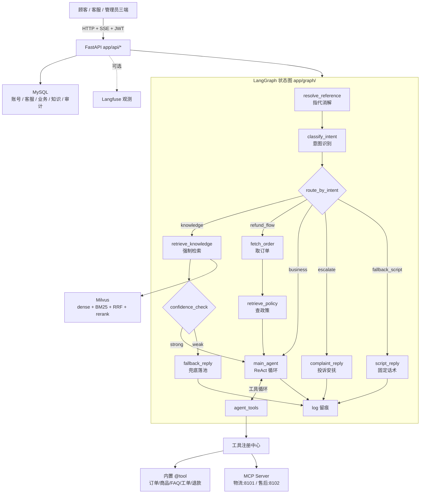

# MewHelp — 生产级电商 AI 智能客服

[](https://github.com/Zennanzhoudev-Pixel/mewhelp/actions/workflows/ci.yml)


> 一个能查订单物流、答政策 FAQ、走退款子流程、挖知识补库、还能微调主题分类器的完整电商智能客服系统。

本仓库是《AI Agent 智能客服实战》的配套实现，代码随课程一章章长成，不分支：ch01 一个纯对话接口起步，到 ch10 收尾时是「Workflow 确定性骨架 + 主力 Agent ReAct 环 + 混合检索 + 数据飞轮 + 主题分类器」的生产形态。

---

## 1. 痛点分析

| 痛点 | 现状（传统/简单做法） | 本项目的解法 |
| --- | --- | --- |
| 客服知识答不准、答不上 | 关键词 LIKE 查表，「邮费」查不到「运费」条目 | BGE-M3 稠密向量 + Milvus 原生 BM25 混合召回，RRF 融合 + bge-reranker 精排（ch03/ch04） |
| 模型乱编订单、物流、政策 | 纯 Prompt 靠模型自觉 | 工具调用查真实数据 + 强制 RAG + 生成前证据置信度闸，不够就拒答（ch04/ch09） |
| 退款/售后越权承诺 | 模型自由发挥 | 确定性退款子流程：取单 → 检索政策 → 只让模型判「这单能不能退」（ch06） |
| 多轮对话记不住、上下文爆 | 全量历史塞 prompt | 三层历史（原文/截短/摘要）+ token 预算 + 前缀缓存（ch07） |
| 缺槽位时模型瞎猜 | 追问或硬编 | LangGraph interrupt/resume：订单选择器、工单预览确认，原地续跑（ch06/ch08） |
| 工具散落、不可控 | 各写各的函数 | 统一注册中心 + 执行引擎：JSON Schema 校验、超时/重试、权限门、审计（ch08） |
| 新工具接入要改代码 | 硬编码工具清单 | MCP 动态发现，内置与 MCP 工具一视同仁，新工具注册即用（ch08） |
| 答不好的问题白流失 | 只记日志 | 数据飞轮：低置信/自评不足/👎 三入口入池 → 标准化查重 → 人工审核 → 写回知识库（ch09） |
| 检索策略好坏说不清 | 凭感觉 | 300 题评估集，四策略分桶跑 Recall@5/MRR/覆盖度/忠实度/拒答率（ch04） |
| 问题分布看不见 | 无归类 | RoBERTa-wwm-ext 多标签主题分类器，旁路批量归类（ch10） |
| 链路排障无从下手 | 只能看日志 | Langfuse 自部署全链路 trace，节点级 prompt/工具/检索/token/耗时（ch09） |

## 2. 能跑到什么程度

| 能力 | 状态 |
| --- | --- |
| 纯逻辑/单元测试（chunking、检索编排、意图分流、上下文、工具引擎、飞轮、taxonomy 等） | ✅ 本地可跑，无需外部服务 |
| 全量测试套件（含 MySQL / Milvus / MCP 集成） | ✅ 本地 **467 passed**；GitHub Actions 随 push 复跑 |
| Web 应用、独立登录页与角色工作台 | ✅ 顾客聊天 `/`、客服 `/agent`、管理 `/console`、账号管理 `/admin/users` |
| 真实对话 / 工具调用 / 检索 / 飞轮 / 评估 | ⚠️ 需要你填 `.env` 三组上游密钥，并起 MySQL + Milvus（+ Langfuse） |
| ch10 训练 / ONNX 导出 | ⚠️ 重依赖走 `ml` 组，需 GPU/MPS 或较长时间 CPU 训练 |
| 扫码 / 短信 / 密码登录、JWT、RBAC、多租户 | ✅ 代码完成；真实短信与企业 SSO 需配置短信网关或企业应用凭据 |
| 人工客服闭环 | ✅ 顾客转人工 → 排队 → 客服认领 → 回复 → 顾客轮询接收 → 结束会话 |

详细能力边界见 [docs/STATUS.md](docs/STATUS.md)。

### 登录、角色与工作台

| 角色 | 首页 | 权限 |
| --- | --- | --- |
| `customer` 顾客 | `/` | 与 AI 对话、查看自己的会话、转人工、提交反馈 |
| `agent` 人工客服 | `/agent` | 查看租户内人工队列、认领、回复、释放、结束会话 |
| `admin` 管理员 | `/console` | 账号与角色、知识库、评估、飞轮、观测、模型验收、客服工作台 |
| `viewer` 兼容角色 | 无独立工作台 | 保留给接入方做只读审核扩展，当前不开放管理 API |

- 独立登录页 `/login`：扫码确认、手机号验证码、账号密码三种方式。
- 二维码是本系统的一次性确认登录，不依赖第三方；飞书/企微原生扫码属于企业 OAuth SSO，
  需要在企业后台创建应用并注入凭据。
- 短信采用 `console` / `webhook` 适配层：本地用控制台验证码，生产对接企业短信网关。
- 账号菜单支持修改密码和退出登录；管理员可在 `/admin/users` 创建账号、分配角色、停用账号和重置密码。

## 3. 技术栈

| 层 | 技术 |
| --- | --- |
| 服务层 | FastAPI 0.139 + SQLAlchemy 2.0 async + asyncmy |
| 编排层 | LangChain 1.3 + LangGraph 1.2（StateGraph + AsyncSqliteSaver） |
| 检索层 | Milvus Standalone 2.6 + BGE-M3 嵌入 + bge-reranker-v2-m3 重排 |
| 存储层 | MySQL 8（业务/知识/审计/飞轮/评估/主题） |
| 工具生态 | LangChain `@tool` + MCP（官方 Python SDK，Streamable HTTP） |
| 可观测 | Langfuse 4 自部署（trace / cost） |
| 模型微调 | RoBERTa-wwm-ext 全参微调 + ONNX Runtime |
| 前端 | 原生 HTML/CSS/JS + SSE；顾客端、客服端、管理端三套界面 |
| 工程 | uv / pytest / GitHub Actions / Docker Compose |

## 4. 架构总览



完整架构说明见 [docs/ARCHITECTURE.md](docs/ARCHITECTURE.md)。

## 5. 快速开始

### 5.1 准备

- Python 3.12、[uv](https://docs.astral.sh/uv/)、Docker（MySQL + Milvus）
- 三组上游密钥：聊天 / 嵌入 BGE-M3 / 重排 bge-reranker-v2-m3（可同一家）

### 5.2 安装依赖

```bash
uv sync
```

### 5.3 配置

```bash
cp .env.example .env
```

编辑 `.env`，至少填：

```bash
CHAT_BASE_URL=https://api.siliconflow.cn/v1
CHAT_MODEL=deepseek-ai/DeepSeek-V4-Flash
CHAT_API_KEY=sk-xxx
EMBED_API_KEY=sk-xxx
RERANK_API_KEY=sk-xxx
```

### 5.4 起依赖与初始化

```bash
docker compose up -d        # MySQL + Milvus Standalone
make milvus-up              # 等 Milvus 健康检查通过
make seed && make seed-conv # 业务 FAQ / 历史会话种子
make kb-build && make kb-vectorize   # 建知识库并向量化
# 已有 MySQL 数据卷升级到账号/人工客服表结构（幂等）
make db-migrate
```

### 5.5 启动

```bash
make dev
```

浏览器打开 <http://localhost:8000/login>。用管理员登录后进入 `/console`，在“账号与权限”
创建客服账号；顾客可从登录页创建账号或由管理员分配。部署细节见
[docs/DEPLOYMENT.md](docs/DEPLOYMENT.md) 与 [DEPLOY.md](DEPLOY.md)。

## 6. 配置

全部配置走 `.env`（`app/config.py` 的 `Settings`），不写死在代码里。三组上游各配各的：

| 组 | 变量 | 说明 |
| --- | --- | --- |
| 聊天 | `CHAT_BASE_URL` / `CHAT_MODEL` / `CHAT_API_KEY` | OpenAI 协议；模型名必须是上游真名 |
| 嵌入 | `EMBED_BASE_URL` / `EMBED_MODEL` / `EMBED_API_KEY` | 默认 BGE-M3（`BAAI/bge-m3`） |
| 重排 | `RERANK_BASE_URL` / `RERANK_MODEL` / `RERANK_API_KEY` | 默认 `BAAI/bge-reranker-v2-m3`（Jina/Cohere 形状） |
| 存储 | `DATABASE_URL` / `TEST_DATABASE_URL` / `MILVUS_URI` | MySQL / Milvus 地址 |
| 编排 | `TOKEN_BUDGET` / `MAX_AGENT_STEPS` / `RERANK_TOP_K` / `EVIDENCE_CONFIDENCE_THRESHOLD` | 调优常量 |
| 工具 | `MCP_LOGISTICS_URL` / `MCP_AFTERSALES_URL` / `TOOL_DEFAULT_TIMEOUT` | MCP 与超时 |
| 可观测 | `LANGFUSE_PUBLIC_KEY` / `LANGFUSE_SECRET_KEY` / `LANGFUSE_BASE_URL` | 三者齐全才挂回调，缺省照常跑 |
| 登录 | `AUTH_ENABLED` / `JWT_SECRET` / `PUBLIC_BASE_URL` | JWT、扫码可访问地址 |
| 短信 | `SMS_PROVIDER` / `SMS_WEBHOOK_URL` / `SMS_WEBHOOK_TOKEN` | 本地 console；生产企业短信网关 |

完整变量表与调参说明见 [docs/CONFIGURATION.md](docs/CONFIGURATION.md)。

## 7. 主要接口

| 方法 | 路径 | 用途 |
| --- | --- | --- |
| POST | `/api/chat` | 前端主入口，SSE 流式（delta/tool/citations/actions/interrupt/done） |
| POST | `/api/agent` | 非流式 JSON，返回答案 + 工具轨迹 + 建议动作 / 中断负载 |
| POST | `/api/extract` | 售后描述结构化提取（订单号/诉求/期望方案） |
| POST | `/api/actions/create-ticket` | 建工单（用户点确认后） |
| POST | `/api/actions/create-refund` | 提交退款申请 |
| POST | `/api/actions/resume` | 中断续跑（订单选择 / 工单确认） |
| GET | `/api/conversations` | 会话侧栏列表 |
| GET | `/api/conversations/{id}/messages` | 回载历史原文 |
| POST | `/api/feedback` | 👍/👎 反馈（👎 入飞轮） |
| GET/POST | `/api/kb/*` | 知识库概览、预览、录入、向量化、检索自测、暂存审批 |
| GET/POST | `/api/review/*` | 飞轮待审队列、详情、通过/驳回 |
| GET | `/api/topics/distribution` | 主题分布统计 |
| GET | `/api/rag-eval/*` | RAG 评估报告与编造个案台账 |
| GET | `/api/observability/overview` | 成本/质量看板 |
| GET/POST | `/api/jobs/*` | 白名单作业运行器（重跑建库/评估/挖知识） |
| GET | `/api/acceptance/*` | 分类器验收与数据视图 |

请求/响应结构、SSE 帧格式与模块函数说明见 [docs/API.md](docs/API.md)。

## 8. 目录结构

```
app/
  api/        HTTP 入口（chat/agent/extract/actions/conversations/feedback/kb/review/topics/rageval/observability/admin/jobs/acceptance）
  core/       单点能力（llm/prompts/embeddings/retrieval/rerank/coref/intent/query_understanding/memory/summarizer/confidence/selfcheck/flywheel/observability/taxonomy/model_guard/read_notes/jobs）
  graph/      LangGraph（state/routing/nodes/build/runtime）
  kb/         切块/文档/去重/挖知识/双写 Milvus（chunking/documents/dedup/mining/dualwrite/milvus_client/sources）
  tools/      工具系统（registry/engine/mcp_client/builtin/*）
  db/         模型与仓储（12 张表）
  schemas/    请求响应模型
  static/     12 个前端页面
mcp_servers/  物流(:8101) / 售后(:8102) 两台 MCP Server
scripts/      建库/评估/飞轮/微调/冒烟（45 个脚本）
sql/          ch02–ch10 建表与迁移
data/kb/      6 份知识库源文档
tests/        78 个测试文件（含 300 题评估集）
docs/         架构/设计/接口/配置/测试/部署/合规/状态 + 各章 spec 与 plan
```

## 9. 测试

```bash
make test          # 全量 pytest（需 MySQL + Milvus 起好；当前 467 个）
make eval          # ch01 结构化提取标注样例
make eval-agent    # ch02 工具选中标注样例
make eval-retrieval# ch03 语义召回
make eval-rag      # ch04 四策略分桶评估（300 题）
make eval-ch05/-ch06/-ch07/-ch08
make flywheel-samples && make eval-flywheel
make ch10-golden / ch10-eval
```

测试策略（TDD / 标注样例 / 评估集 / CI）见 [docs/TESTING.md](docs/TESTING.md)。

## 10. 部署

- 本机开发：`make dev`（自动拉起 MCP Server + 应用）
- 依赖服务：`docker compose up -d`（MySQL + Milvus + MinIO + etcd）
- 观测：`make langfuse-up`（独立 compose，:3000）
- 生产化建议、端口、健康检查、排障见 [docs/DEPLOYMENT.md](docs/DEPLOYMENT.md)

## 11. 数据合规

- 密钥只放 `.env`（已 gitignore），不写进代码/文档/测试；
- Langfuse 自部署，链路数据默认不出内网；
- 工具审计、问题池、评估报告均落本地 MySQL；
- 生产接入前需补齐鉴权、PII 脱敏、保留期与删除策略（演示版未实现）。

详见 [docs/COMPLIANCE.md](docs/COMPLIANCE.md)。

## 12. 文档索引

| 文档 | 内容 |
| --- | --- |
| [docs/ARCHITECTURE.md](docs/ARCHITECTURE.md) | 分层架构、状态图、检索/工具/上下文/飞轮数据流 |
| [docs/DESIGN.md](docs/DESIGN.md) | 痛点、设计思路、设计原理、关键决策与权衡 |
| [docs/API.md](docs/API.md) | 接口契约、SSE 帧、请求响应、核心函数 |
| [docs/CONFIGURATION.md](docs/CONFIGURATION.md) | 全部环境变量与调参说明 |
| [docs/TESTING.md](docs/TESTING.md) | 测试分层、评估集、CI |
| [docs/DEPLOYMENT.md](docs/DEPLOYMENT.md) | 部署、端口、排障 |
| [docs/COMPLIANCE.md](docs/COMPLIANCE.md) | 数据合规与安全边界 |
| [docs/STATUS.md](docs/STATUS.md) | 能力状态矩阵与已知限制 |
| [docs/FAQ.md](docs/FAQ.md) | 常见问题与踩坑 |
| [docs/PRODUCTION.md](docs/PRODUCTION.md) | 生产加固清单(鉴权/限流/熔断/多副本等 8 项) |
| [docs/IDENTITY-AND-SUPPORT.md](docs/IDENTITY-AND-SUPPORT.md) | 扫码/短信登录、多角色界面、账号管理与人工客服闭环 |
| [docs/superpowers/](docs/superpowers/) | 各章 spec 与 implementation plan |
| [DEPLOY.md](DEPLOY.md) | 面向 AI 编程助手的逐步部署任务书 |
| [CONTRIBUTING.md](CONTRIBUTING.md) | 贡献流程与代码规范 |
| [SECURITY.md](SECURITY.md) | 安全策略与漏洞上报 |
| [CHANGELOG.md](CHANGELOG.md) | 变更记录 |

## 13. Roadmap

- [x] ch01–ch10 全链路（对话/工具/RAG/混合检索/Workflow+Agent/意图/上下文/MCP/飞轮/微调）
- [x] 鉴权、租户隔离与 RBAC（管理员后台、普通用户界面守卫、会话级租户校验）
- [x] 内存/Redis 限流、熔断、Postgres checkpointer 多副本部署产物与 Prometheus 告警
- [x] 语义检索历史；用户长期画像仍留给业务定义
- [x] Skill 指令包机制；更多外部系统连接器按业务扩展

## 14. License

[MIT](LICENSE)
