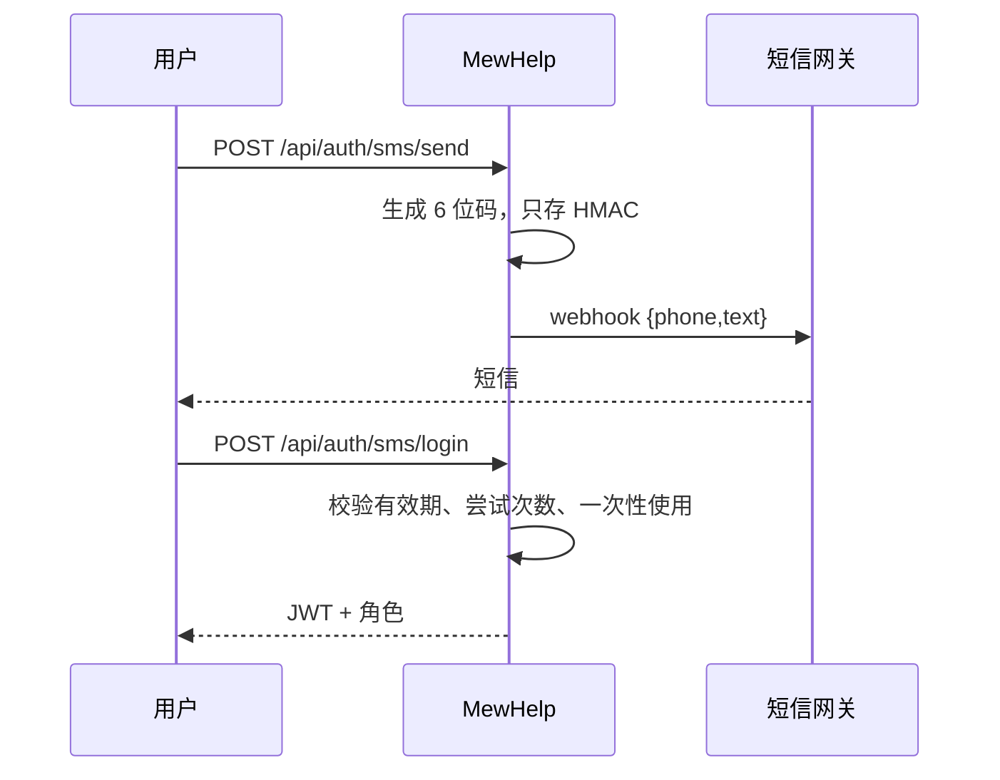
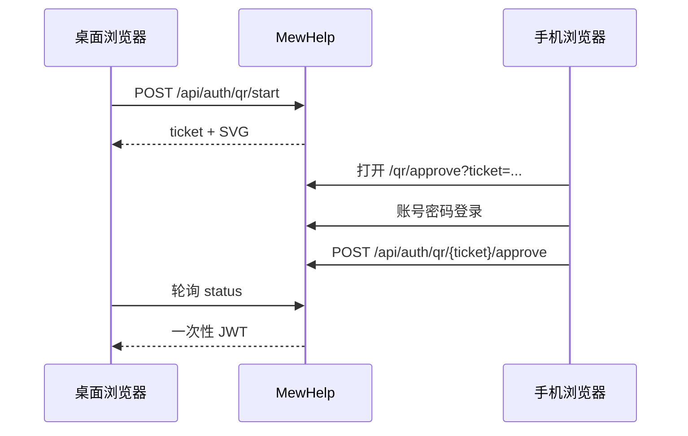
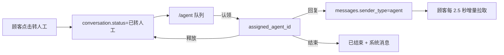

# 统一登录、账号权限与人工客服

本文说明 `/login`、多角色界面、账号管理和顾客转人工闭环的设计、接口与上线边界。

## 1. 角色与界面

| 角色 | 默认首页 | 主要能力 |
| --- | --- | --- |
| `customer` | `/` | AI 对话、自己的会话、转人工、反馈 |
| `agent` | `/agent` | 人工队列、认领、回复、释放、结束会话 |
| `admin` | `/console` | 全部管理能力、账号与角色、人工客服 |
| `viewer` | 无独立界面 | 兼容旧数据；当前不开放管理 API |

登录接口返回角色后，前端按角色跳转；直接打开无权页面时，`auth.js` 会送回对应首页。
后端 `AuthMiddleware` 每次请求从数据库重新读取账号状态、角色和租户，不信任 JWT 内的旧角色。

## 2. 三种登录方式

### 2.1 账号密码

`POST /api/auth/login` → PBKDF2 校验密码 → 签发 JWT。停用账号返回 403。

### 2.2 手机号验证码

本地 `SMS_PROVIDER=console` 会把验证码写入服务端日志；生产必须使用 `webhook`，并设置
`SMS_DEBUG_RETURN_CODE=false`。

### 2.3 二维码确认

票据 2 分钟过期，手机确认后桌面端只能兑换一次。手机必须能访问 `PUBLIC_BASE_URL`.

> 这是本系统自有的二维码确认登录，不等同于飞书/企微原生 OAuth 扫码。若要求员工直接使用
> 飞书或企微扫码，需要在对应企业后台创建应用，获取 `APP_ID/APP_SECRET`、配置回调域名，
> 并新增 OAuth provider；这部分必须由企业管理员授权。

## 3. 账号管理

管理员打开 `/admin/users`:

- 创建顾客、人工客服、管理员；
- 修改角色和账号状态；
- 绑定手机号用于短信登录；
- 重置密码；
- 系统阻止停用或降级当前租户最后一个管理员。

列表只返回当前 JWT 租户内用户，响应不包含密码散列。

## 4. 人工客服闭环

- 顾客转人工后，`/api/chat` 不再调用 AI，只落用户消息并返回排队提示；
- 客服只能回复自己认领的会话；
- 顾客只接收客服/系统增量消息；
- `agent/admin` 能看租户内人工会话，`customer` 只能访问自己的会话；
- 关闭会话后顾客需要新建会话才能继续使用 AI。

当前使用 HTTP 增量轮询，优点是跨代理和多副本稳定；数据量增长后可把同一接口替换成
WebSocket 或 SSE，不改变数据库与权限模型。

## 5. 数据模型

`sql/ch12-console.sql` 新增/扩展：

- `users.phone/display_name/status/last_login_at` 与 `customer` 角色；
- `login_codes`：手机验证码 HMAC、过期时间、尝试次数、一次性使用；
- `qr_login_sessions`：二维码票据状态和一次性兑换；
- `conversations.assigned_agent_id/transfer_reason`；
- `messages.sender_type/sender_id`，区分 AI、顾客、人工客服、系统。

已有数据库执行一次 `make db-migrate`；全新 MySQL 初始化会自动按文件名顺序执行。

## 6. 上线前必须由部署方完成

1. 设置强 `JWT_SECRET`，密钥从 Vault/KMS/Secret 注入。
2. 配置手机可访问的 HTTPS `PUBLIC_BASE_URL`。
3. 对接企业短信网关，关闭本地 debug 验证码。
4. 如需飞书/企微原生扫码，创建企业 OAuth 应用并提供凭据。
5. 用 `/admin/users` 创建正式客服和管理员，停用临时验收账号。
6. 检查 TLS、角色隔离、跨租户 404、人工队列告警与聊天数据保留期。
